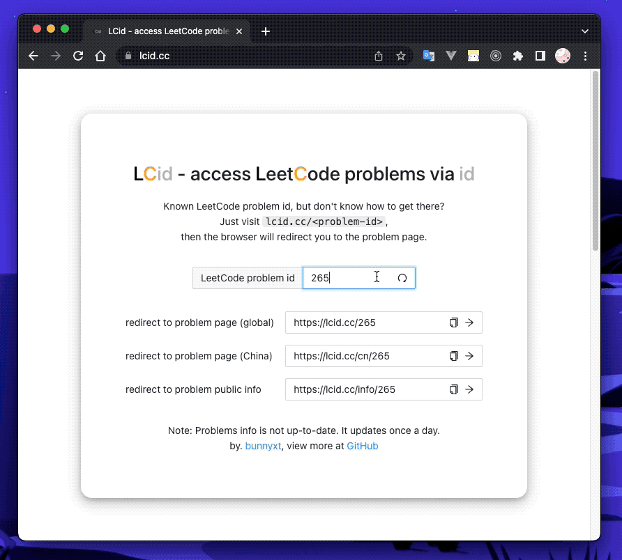

# LCid - access LeetCode problems via id

## Introduction

As a world's leading online programming learning platform, [LeetCode](https://leetcode.com) is quite popular among programmers. Since each problem has a unique number id, users tend to share problems via id. However, it is not convenient to visit problem page **directly via id**. People have to visit [LeetCode Problems](https://leetcode.com/problemset/all/) firstly, then enter that number id in the 'Search questions' input box, press 'enter', click the problem title link, finally comes to the problem page. What a hard work!

This simple project, called LCid, provides directly access to LeetCode problems via id. Features:

- Fetch all LeetCode problems via crawler.
- Redirect to LeetCode problem page with problem id in the URL path via backend.
- Support both LeetCode [global site](https://leetcode.com/problemset/all/) and [China site](https://leetcode.cn/problemset/all/) redirect.
- CI/CD, fetch all LeetCode problems daily and commit back to the repository via GitHub Actions, then deploy the latest snapshot.



LCid is now available at [lcid.cc](https://lcid.cc). Just add `/<problem-id>` at the end of `lcid.cc` (e.g. [lcid.cc/1](https://lcid.cc/1)), then browser will redirect you to the problem page. Simple, fast, and make your live easier.

What's more, to redirect to China site, add `/cn/<problem-id>` instead (e.g. [lcid.cc/cn/1](https://lcid.cc/cn/1)). Interested in the brief info of the problem? Try `/info/<problem-id>` (e.g. [lcid.cc/info/1](https://lcid.cc/info/1)) and find more!

<!-- More technical details introduced at [this blog](https://www.bunnyxt.com/blogs/lcid-cc-leetcode-problems-redirect-via-id/) (Chinese only). -->

## Environment

To start LCid on your local machine, you should have `python 3.7+` installed.

The crawler is implemented with `urllib3` and backend is powered with `flask`.

To install all those dependencies, execute `pip install -r requirements.txt`.

The frontend is built with `React.js` with `Ant Design` UI.

To build frontend, use `Node.js 22.x` with `npm 10.x`.

(older versions may work but not tested)

## Usage

### Set environment

Updated Oct 29 2023, leetcode.com now protected with Cloudflare. To send request to any page or endpoint under leetcode.com, `cf_clearance` and `csrftoken` are required.

For now, it is difficult to automate way to get both `cf_clearance` and `csrftoken`. Therefore, it is okay to manually get from browser for now.

Once we fetched `cf_clearance` and `csrftoken` from browser, copy file `.env` to `.env.local`, fill both fields accordingly.

```
VITE_BACKEND_API_URL="http://localhost:1437"
LC_CF_CLEARANCE="{manually get from browser}"
LC_CSRFTOKEN="{manually get from browser}"
```

### Fetch All Problems

To fetch all problems, execute `python fetch_problems_all.py`. Then, you will see the logs below.

```zsh
Now load cf_clearance and csrftoken...
Loaded cf_clearance and csrftoken.
Now try get LeetCode problems total count...
Found 3333 problems in total.
Now try fetch all 3333 LeetCode problems...
All 3333 problems fetched.
All 3333 problems info saved into problems_all.json file.
```

After few seconds, all problems info have been saved into `problems_all.json` file in json format.

### Build Frontend

To start frontend, install all dependencies via `npm install` first. Then, start frontend development server via `npm run start`. By default, the development server will starts at `http://localhost:3000`.

To build frontend, use `npm run build`. The built frontend will be created at `build/`.

### Start Backend Service

To start backend service, execute `python app.py <port>` (e.g. `python app.py 1437`). Then, the backend server will start at `localhost:<port>`.

Now you can try the following endpoints. All of them should work correctly.

- `localhost:<port>/`
- `localhost:<port>/1`
- `localhost:<port>/cn/1`
- `localhost:<port>/info/1`

## Deployment

The production project runs on Vercel at [lcid.cc](https://lcid.cc) and [www.lcid.cc](https://www.lcid.cc). Cloudflare provides DNS; both hostnames point directly to Vercel with its proxy disabled. Vercel manages the HTTPS certificate and renews it automatically.

GitHub Actions fetches LeetCode problems daily and commits `problems_all.json` to `main` ([workflow](.github/workflows/main.yml)). Its LeetCode cookies belong in GitHub Actions secrets, not in Vercel. Commits to `main`, including commits made by the workflow, trigger a Vercel deployment. Each deployment builds the Vite frontend and copies that committed snapshot to `build/info.json`. On Vercel, `/info` rewrites to this static JSON file; the small function in `api/problem.js` handles individual info and redirects. Thus `/info` changes when a deployment publishes a new snapshot.

The checked-in [vercel.json](vercel.json) selects `build/` as the output directory and preserves the existing `/info`, `/info/<id>`, `/cn/<id>`, and `/<id>` URLs. Keep `VITE_BACKEND_API_URL` empty in production so the frontend fetches `/info` from the same origin.

To verify a deployment, check the latest deployment in the [Vercel project](https://vercel.com/bunnyxts-projects/lcid), then test `/`, `/info`, `/info/1`, `/1`, and `/cn/1` over HTTPS on both hostnames. The Heroku app is retained with its web dyno scaled to zero and automatic deployment disabled. For a rollback, deploy the desired commit to Heroku, scale its web dyno back up, and restore the former Heroku DNS targets for both hostnames in Cloudflare. Recheck HTTPS and the routes after DNS propagates.

### Redirect analytics

The Vercel production function records one PostHog `redirect_attempt` event for each GET or HEAD request to `/<id>` or `/cn/<id>`. An event contains its UTC timestamp, `problem_id`, `target_site` (`leetcode.com` or `leetcode.cn`), `status_code`, and `success` (`true` for a 302 redirect, `false` for an unknown ID's 404). A 302 means LCid issued the redirect; it cannot establish whether LeetCode subsequently loaded in the visitor's browser. `/info`, `/info/<id>`, the homepage, and OPTIONS requests are excluded. PostHog's project setting discards client IP addresses; LCid does not send visitor IPs and disables GeoIP enrichment from the Vercel server's location.

Set `POSTHOG_PROJECT_TOKEN` as a Vercel production environment variable to enable capture. The function sends the event in the background so analytics failures do not block the redirect; delivery errors appear in Vercel function logs. Function failures that occur before the handler runs are visible only in Vercel logs and are not counted as PostHog events.

View redirect counts and the breakdown by `problem_id`, `target_site`, or `success` in the [LCid PostHog project](https://us.posthog.com/project/658935). A daily S3-compatible batch export writes gzip-compressed JSON Lines to the private Cloudflare R2 bucket `lcid-redirect-events` under `redirect-events/{year}/{month}/{day}/`. Download raw files from the [R2 bucket](https://dash.cloudflare.com/b6e8a9a259366668bfc54143858f54ce/r2/default/buckets/lcid-redirect-events). Keep the bucket private and the R2 access key out of this repository.

## Disclaimer

- This is just a naive tool for convenient access and only call LeetCode API at low frequency. It only obtains public accessible data (no personal info or paid content collected and distributed). DO NOT ABUSE LEETCODE API!!!
- GitHub Repo: [bunnyxt/lcid](https://github.com/bunnyxt/lcid)
- Author: [bunnyxt](https://github.com/bunnyxt)
- License: [MIT](LICENSE)
